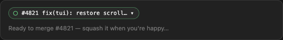
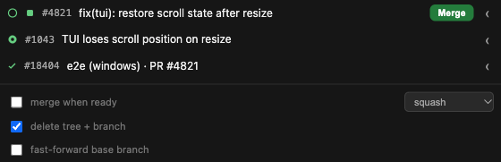
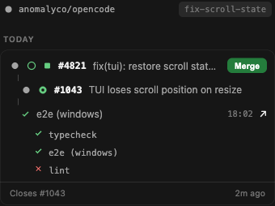
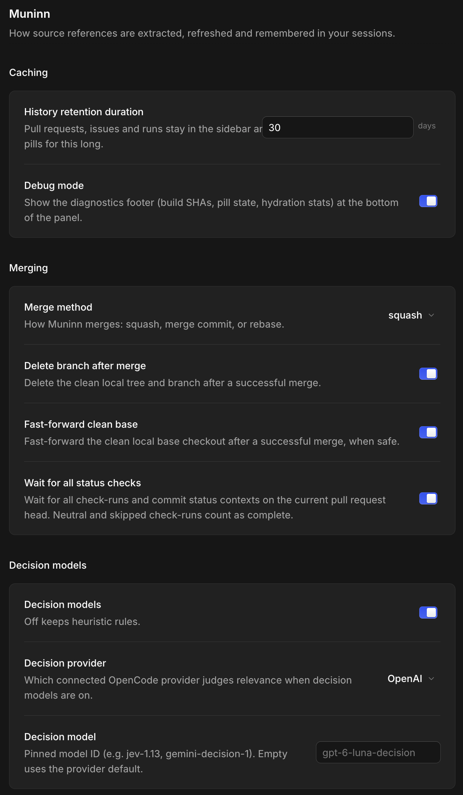

# muninn

Named for Odin's raven of memory — it remembers what an OpenCode session ships.

Tracks what an OpenCode session ships: pull requests, issues, and CI runs —
extracted from the conversation, hydrated from the forge, and shown live in
OpenCode Desktop.

## What it looks like









## Add the plugin

Install the plugin directly from its GitHub repository with OpenCode's plugin
manager. OpenCode documents the `github:owner/repo` form for `plugin add` in its
[plugin docs](https://opencode.ai/docs/plugins/#manage):

```sh
opencode plugin add github:esafak/muninn
```

To test a pull request before it merges, install its branch the same way:

```sh
opencode plugin add github:esafak/muninn#docs/readme-screenshots-settings-audit
```

Branches, tags, and full commit hashes all work.

OpenCode watches configuration directories and may load the plugin automatically;
if it does not appear, restart OpenCode Desktop. See the [plugin reload
notes](https://opencode.ai/docs/plugins/#reload).

For development and contributor guidance, see [CONTRIBUTORS.md](CONTRIBUTORS.md).
